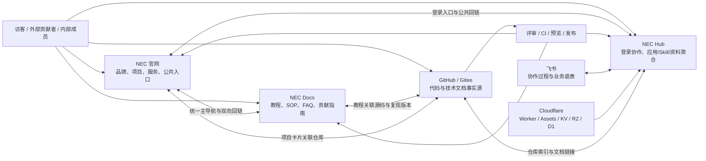

# NEC 网站维护白皮书

> 统一入口、统一规范、分仓维护、分层部署  
> 覆盖 NEC 官网、NEC Docs、NEC Hub、代码仓及其协作体系

## 文档控制

| 项目 | 内容 |
| --- | --- |
| 文档版本 | V1.0 |
| 编制日期 | 2026-11-08 |
| 当前状态 | 试行稿；待官网与文档仓负责人确认后转正式 |
| 适用范围 | 对外官网、文档站、团队中台、公开代码仓，以及与发布有关的飞书和 Cloudflare 资源 |
| 建议归口 | 网站总维护负责人；本稿暂存于中台仓 `docs/` |
| 建议复审 | 每季度一次，或在域名、仓库、部署平台、负责人发生重大变化时即时复审 |
| 输入材料 | 《NEC新能源开发者社区-机器人.pdf》、中台仓 README、品牌战略 PRD 及现有维护资料 |

### 表述约定

为避免把规划误当成现状，本文使用以下标记：

- **现状**：已由本仓 README、配置或附件明确的信息；仅表示编制时已核对，不代表永久有效。
- **目标**：本白皮书确定的长期架构方向，需要按实施计划落地。
- **建议**：待负责人或团队批准的运营参数、流程和工具选择。
- **待确认**：当前材料不足以确认，不能据此声称已经上线或已有承诺。

官网和文档仓的实际源码、流水线及运行配置未在本次工作中核验。因此，涉及其技术栈、预览环境、自动部署、搜索、重定向和监控的内容均按目标或待确认事项处理。中台统一使用飞书 OAuth 是已核实的现状，**不能据此宣称官网、文档站已经实现统一 SSO**。

---

## 1. 执行摘要

NEC 需要一个看起来统一、用起来连贯、维护时又不相互拖住的网站体系。长期方案不是把官网、文档、中台和代码强行合成一个仓库或一个应用，而是：

> **统一入口、统一规范、分仓维护、分层部署；一个内容只设一个事实源，所有变更都有负责人、审核、验证和回滚路径。**

四类站点保持清晰分工：

- **NEC 官网**：解释 NEC 是谁、做什么、有哪些项目与服务，承担品牌展示、公共信息发布和用户转化。
- **NEC Docs**：承载 Quickstart、教程、复现步骤、SOP、FAQ 和贡献指南，降低学习、复现与参与成本。
- **NEC Hub**：承载登录后的团队协作，以及应用、Skill、资料的聚合入口和流程数据。
- **代码仓**：保存代码与技术文档的版本化事实源，提供评审记录、版本标签和回滚依据。

飞书继续承担协作过程和业务底表，Cloudflare 继续承载中台运行资源。二者不是所有公共内容的复制目的地，也不能替代 Git 的版本管理。

长期维护依赖以下六项基础制度：

1. 统一主导航和双向回链，访客在任一站点都能回到其余入口。
2. 建立内容事实源矩阵，禁止同一正文在多处手工双向同步。
3. 每项资产有负责人和 AB 角，每个仓库有明确的默认分支、评审与发布规则。
4. 所有站点变更执行“变更单—预览—审核—发布—冒烟—回滚准备”的闭环。
5. 权限、密钥、隐私、备份和恢复演练与功能维护同等重要。
6. 通过日、周、月、季、年度节奏持续维护，而不是上线后一次性交付。

---

## 2. 背景与维护目标

### 2.1 社区背景

附件将 NEC 描述为起源于 2022 年 ROBOCON 团队、面向学生与青年工程师的机器人开源技术社区，采用“开源社区 × 团队验证 × 工程服务”的模式，覆盖机械、电控、电机驱动、机器视觉、AI 落地和运营治理等方向。

附件列举了 Duma、MechDog、5 轴流体工作站、AGL on openEuler、星闪手柄、灵巧手与气动系统等项目示例，以及 NEC+、竞赛培训、企业 AI 咨询、机器人套件、原型加工和横向开发等服务示例。附件同时给出木兰宽松许可证第 2 版（Mulan PSL v2）、Gitee/GitHub 双仓、飞书 Wiki、贡献者晋升、Good First Issue 和导师配对等规划或实践信息。

这些内容适合用于理解社区定位，不应直接变成网站的实时运营数据。附件中的人数、排名、价格、部署量等属于特定时点的路演口径，不纳入本白皮书的实时事实基线；其提到的 Mintlify 等工具，也不能未经核验就写成当前上线事实。

### 2.2 需要长期解决的问题

- 网站入口存在，但导航名称、返回路径和移动端体验容易逐渐不一致。
- 同一项目介绍、SOP 或联系方式可能散落在官网、文档、飞书和多个仓库，更新后相互冲突。
- 文档“能发布”但没有人负责复核，历史方案与当前实现混杂。
- 跨仓修改缺少统一变更单，发布失败时难以定位影响范围和回滚版本。
- 构建产物可能被手工修改，造成下一次构建覆盖或线上与源码不一致。
- 账号、域名、密钥、定时任务和数据备份若只由单人掌握，换届或离职后会形成中断风险。

### 2.3 维护目标

**目标一：找得到。** 用户从官网、文档站、中台或代码仓出发，最多通过清晰的一层导航进入目标站点；返回路径同样明确。

**目标二：信得过。** 公共信息标明负责人和复核状态，技术运行说明跟随代码版本，历史数据注明统计时点。

**目标三：改得动。** 内容Owner只修改自己的事实源，跨仓调整通过变更单协同，不需要口头通知多处复制。

**目标四：发得稳。** 常规变更有预览、审核和冒烟；高风险变更有回滚版本和窗口；紧急修复有事后补录。

**目标五：接得住。** 任一关键岗位均有备份人，账号、域名、流水线、数据和未结事项可以标准化交接。

---

## 3. 已核实的架构基线

### 3.1 官方入口

| 资产 | 地址 | 编制时口径 |
| --- | --- | --- |
| NEC 官网 | <https://www.newenergycoder.club> | 附件确认的公共官网入口 |
| NEC Docs | <https://docs.newenergycoder.club> | 附件确认的文档入口 |
| NEC Hub | <https://hub.newenergycoder.club> | 中台仓 README 确认的生产入口 |
| 社区 Gitee 仓 | <https://gitee.com/darrenpig/new_energy_coder_club> | 附件列出的公开仓库 |
| 社区 GitHub 仓 | <https://github.com/Darrenpig/new_energy_coder_club> | 附件列出的公开仓库 |
| 中台 GitHub 仓 | <https://github.com/necc-hub/nec-hub> | README 确认的中台源码仓 |
| 中台 Gitee 镜像 | <https://gitee.com/darrenpig/nec-hub> | README 确认的镜像仓 |

本白皮书只使用已确认的站点根地址，不虚构官网、文档站或中台的深层链接。新增公开深链前，应加入链接清单并验证状态码、页面归属和返回导航。

### 3.2 中台现状

根据本仓 [README](../README.md)：

- 中台是单体 Cloudflare Worker，承载门户、飞书 OAuth、API、MCP、R2 应用托管、KV 注册表和 D1 报销 ERP 快照。
- 门户包含我的首页、任务、图纸/硬件/合同评审、报销、赛季目标、应用广场、Skill 中心、资料页、开源仓库、数据/PRD 看板和 NEC-MCP 等能力。
- 前端是独立的 Vue 3 + Vite 工程，源码在 `web/`，构建输出到 `public/portal-assets/`。
- `public/index.html`、`public/apps/*/index.html`、`public/portal-assets/` 属于构建产物，不应手改；手写静态资源位于 `public/brand/`、`public/docs/`、`public/assets/`。
- 标准校验与开发命令为 `npm run check`、`npm test`、`npm run dev:web`、`npm run build:web`；Worker 本地开发使用 `npm run dev`，端口为 8787。
- PR 执行类型检查；推送 `main` 后先运行 vitest，再执行 `wrangler deploy`。手工部署入口为 `./scripts/deploy-hub.sh`。
- 资源包括 KV `REGISTRY`、R2 `APPS_BUCKET`、D1 `ERP_DB` 和 Assets；泛域名可直达 R2 应用。
- 应用、Skill、资料分别通过 `deploy_app`/`register_app`、`publish_skill`、`publish_doc` 登记；`/api/apps`、`/api/skills`、`/api/docs`、`/api/repos` 提供聚合数据。
- 登录使用飞书 OAuth + HttpOnly Cookie，角色依据队员名单解析；财务信息按角色脱敏；MCP 写操作需要管理 token。

README 中仍列为待办的能力，不得在网站或白皮书中写成已经完成，尤其包括图纸评审完整闭环、合同审批 AI 预填、飞书工作台入口和 Skill 仓库 CI frontmatter 校验等。

### 3.3 品牌口径边界

[品牌战略 PRD](./PRD_品牌战略与生态用户心智占领_V1.0.md) 是 2026-11-05 创建、2026-11-06 复核的**评审稿，尚未批准执行**。本白皮书借用其平台命名方向：

- 对外主品牌建议使用 `NEC`，中文建议写作“常州工 NEC”。
- 平台名称使用 `NEC 官网`、`NEC Docs / 文档中心`、`NEC Hub`。
- `necc-hub` 仅作为技术组织和工程标识，不作为大众主品牌。
- 优先复用既有官网、Docs、Hub、GitHub/Gitee，不另建“品牌大数据平台”。

`BUILT TO DAWN · 为黎明而造`、“做真实工程，来常州工 NEC”以及具体首屏 CTA 均属于**待品牌评审冻结的建议**，不是本白皮书认定的现行标准。附件中的“让开源技术触手可及”也不能自动替代正式品牌口号。

早期中台搭建文档中的 Pages、Astro 等描述只作为历史背景；当前实现以 README 和可核验配置为准。专项文档自述的“准确率 100%”等指标不能扩展为全站质量结论。

---

## 4. 目标总体架构

### 4.1 架构原则

1. **逻辑统一，物理解耦。** 用户体验统一，代码仓和部署故障域按需隔离。
2. **公开与内部分层。** 官网和文档站服务公开访问，中台服务登录协作，业务底表不直接暴露。
3. **内容就近维护。** 品牌内容靠近官网，教程靠近使用场景，技术说明跟随代码，业务记录留在业务系统。
4. **索引与正文分离。** 中台可以聚合应用、Skill 和资料索引，但不复制各站所有正文。
5. **自动化优先，人工审批兜底。** 重复检查交给 CI；品牌、权限、数据和生产发布由责任人判断。
6. **不为统一而重写。** 优先增加导航、元数据、校验和发布规范，避免一次性迁移全部站点。

### 4.2 目标关系图



图中箭头表示目标和现有能力的组合，不代表所有导航与自动化已经完成。官网和文档站的 CI 来源、预览方式与部署目标需要分别核验。

### 4.3 各层职责边界

| 层级 | 负责 | 不负责 |
| --- | --- | --- |
| 官网 | 品牌解释、项目与服务展示、公共新闻、联系与参与入口 | 完整教程、内部审批数据、大段源码说明 |
| 文档站 | 学习路径、复现步骤、SOP、FAQ、贡献指南、版本化知识 | 实时业务状态、未经授权的内部资料 |
| 中台 | 登录工作台、流程协作、应用/Skill/资料索引、业务看板 | 代替公开官网做完整品牌叙事、复制全部文档正文 |
| 代码仓 | 源码、技术 README、变更历史、Issue/PR、发布标签 | 无版本意识的宣传文案、明文密钥 |
| 飞书 | 协作过程、队员名单、业务底表、内部通知 | 公共网站唯一备份、公开内容的自动全文镜像 |
| Cloudflare | 中台计算、静态资产、KV/R2/D1 等运行资源 | 内容责任划分、跨仓评审制度 |

### 4.4 统一信息架构

**目标**下，公共主导航保持同一顺序和命名：

1. `首页`：返回 NEC 官网根地址。
2. `文档`：进入 NEC Docs 根地址。
3. `中台`：进入 NEC Hub；未登录用户看到明确的登录与公共返回入口。
4. `开源仓库`：进入当前站点指定的主仓库或仓库索引页；同时提供另一托管平台的镜像入口。

项目、服务、应用、Skill 等二级入口可因站点职责不同而变化，但不得改变四类主入口的含义。导航中的“中台”只表示 NEC Hub，不应再跳转到含义不清的第三方页面。

---

## 5. 跳转与链接维护规范

### 5.1 导航与回链

- 所有站点在桌面端和移动端均提供一致的主导航；窄屏折叠菜单仍须保留官网、文档、中台和仓库入口。
- 当前站点使用可识别的选中状态； logo 的默认行为统一为返回 NEC 官网首页，当前站点首页另由“首页”或面包屑承担。
- 深层页面提供返回本站首页和返回上级页面的路径；跨站页面提供“继续阅读/前往操作”的明确链接。
- 从官网进入中台属于公开到登录区的跨越，应标注“内部工作台/需登录”；中台保留“返回官网”和“查看文档”。
- 跨站及外部链接建议新窗口打开，并保留 `noopener`/`noreferrer` 安全属性；同站导航不强制新窗口。
- 不用按钮文字“点这里”代替目的说明，使用“查看复现教程”“进入 NEC Hub”“阅读源码”等可预测文案。
- 二维码只作为辅助入口，不能替代可复制的文本 URL。

### 5.2 稳定 URL 与深链

**目标**为每类公共内容建立稳定、可读、低层级且与标题弱耦合的 URL。URL 一旦公开，不随标题润色随意变化。

- 新增链接先登记归属站点、目标 URL、Owner、来源页面和最近验证日期。
- 删除或迁移页面时，优先配置 301 永久重定向；同时更新事实源和已知来源链接。
- 重定向避免多级串联和循环；不得把不存在的具体文档一律重定向到首页。
- 404 页面应说明内容不存在或已迁移，并提供首页、文档、搜索或 Issue 反馈入口。
- 页面锚点变更也按链接变更处理；发布前抽样验证“页面存在”之外的“目标章节存在”。
- 中台动态页面只有在路由和未登录行为实际支持时，才能登记为公共深链。

### 5.3 三类用户路径

**访客了解与转化**  
官网项目/服务页 → 对应文档或参与说明 → 明确咨询、下载、试用或贡献入口。若需要源码，再进入指定主仓库；不让用户在多个首页之间循环。

**外部贡献者复现与提交**  
官网或仓库项目说明 → Docs Quickstart/复现教程 → 对应代码与版本标签 → 贡献指南、Good First Issue 或 Issue 模板 → PR/评审记录。Good First Issue 和导师配对如未正式运行，只能标为计划。

**内部成员协作**  
官网/Docs → NEC Hub 登录 → 我的首页或具体工作区 → 对应应用、Skill、资料或流程记录 → 关联仓库/飞书底表。公共文档不得因方便而直接链接需要权限的底表并泄露字段。

### 5.4 链接检查

建议每周自动检查站点根地址、主导航、页脚、重点项目页和最近新增深链，每月覆盖一次全量公开链接。检查至少包括 DNS/TLS、HTTP 状态、重定向链、目标页面归属、锚点和移动端导航。

仅返回 200 不代表链接正确：若目标被域名停车页、统一门户或错误应用接管，应通过页面标题、标志性正文或指定校验标记识别“软 404”和错误接管。

---

## 6. 内容单一事实源

### 6.1 事实源矩阵

下表是**目标维护规则**。指定事实源不等于该配置已经存在；Owner 应在实施阶段补齐文件或登记位置。

| 内容 | 唯一事实源 | 其他站点如何使用 | 主责角色 |
| --- | --- | --- | --- |
| 品牌名称、视觉、批准口号 | 官网指定的品牌配置/品牌页 | 引用或链接；不各自改写 | 品牌与内容 Owner |
| 项目与服务公共介绍 | 官网指定结构化内容或项目页 | Docs 链接到项目；Hub 只存索引 | 官网 Owner + 项目 Owner |
| Quickstart、教程、SOP、FAQ | 文档仓对应源文件 | 官网/仓库/README 链接到规范 URL | Docs Owner + 技术复核人 |
| 代码运行、构建、环境要求 | 对应代码仓 README 与配置文件 | Docs 引用版本和链接，不复制易漂移命令 | 仓库 Maintainer |
| 应用、Skill、资料聚合索引 | NEC Hub 注册表及对应登记接口 | 各站通过 API 或链接使用 | Hub Owner + 条目 Owner |
| 开源仓库聚合信息 | 中台仓库注册配置与各仓元数据 | 官网展示已审核入口 | Hub Owner + 仓库 Maintainer |
| 队员、任务、评审、报销等业务记录 | 飞书业务底表或中台既定业务系统 | 中台按权限查询；公开站不复制明细 | 对应业务 Owner |
| 报销 ERP 快照 | 中台 D1 既定数据链路 | 仅授权功能使用，不作为公共事实源 | 财务/ERP Owner |
| 发布与变更历史 | Git 提交、PR、Release 和跨仓变更单 | 各站只展示必要摘要 | 各仓 Maintainer |
| 本文维护制度 | 本白皮书及后续批准版本 | 各站链接，不复制出多个不同版本 | 网站总维护负责人 |

### 6.2 引用规则

- 一个正文只保留一个权威版本。其他页面使用链接、摘要卡片或由构建系统生成的只读引用。
- 禁止官网、Docs、飞书和 Git 之间双向手工同步同一正文。确需派生内容时，记录来源、生成方式和更新时间。
- 摘要可以因场景不同而改写，但事实字段必须来自同一来源；许可证、版本、价格、联系方式等不得手工多份维护。
- 教程涉及代码命令时，明确适用版本、提交标签或发布日期。优先执行仓库中的脚本，而不是复制一长段可能过期的命令。
- 主仓 README 只保留项目简介、最短上手路径和权威链接；完整教程移到 Docs，避免 README 变成不可维护的大全。
- 附件、路演稿和历史方案保留原始日期与状态，不用新内容覆盖历史记录；现行页面应链接到当前版本。

### 6.3 GitHub 与 Gitee

每个仓库必须声明一个主仓，另一侧只作为镜像或社区入口，禁止两边同时接受会改变同一分支的独立写入。

- 中台仓按 README：GitHub `necc-hub/nec-hub` 为源码主仓，Gitee `darrenpig/nec-hub` 为镜像。
- 社区仓及其他仓的主镜像关系由各仓负责人确认后登记，不因附件同时列出两个地址就推定同步已经配置。
- Issue/PR 的主处理位置在仓库首页说明；镜像侧引导到主仓，避免问题在两个平台分别积压。
- 镜像同步须记录方向、频率、冲突处理和失败告警。发生分叉时停止盲目强推，由 Maintainer 确认后恢复。
- 双平台托管提高可访问性，但不等同于完整备份；Issue、Release、权限和配置仍需另行保留。

### 6.4 内容元数据

**目标**为需要长期维护的文档和公共页面增加最小元数据。新内容先执行，旧内容分批补齐，不要求一次性改写所有历史文件。

```yaml
title: 页面标题
owner: 责任角色或团队
status: draft | review | published | archived
reviewed_on: YYYY-MM-DD
review_cycle: 90d
canonical_url: 权威页面地址
related_links:
  - 相关文档、仓库或变更单
```

敏感内部文档可不公开 Owner 的个人信息，但必须有可找到的责任角色。超过复核周期的内容进入待复核清单，不应无提示地继续标为“最新”。

---

## 7. 组织、职责与交接

### 7.1 角色设置

团队可一人兼多角，但每个角色必须有主责 A 和备份 B；高风险变更的提交人与最终审核人原则上分离。

| 角色 | 核心责任 |
| --- | --- |
| 网站总维护负责人 | 资产清单、跨站导航、变更节奏、故障协调、季度复审 |
| 官网 Owner | 品牌与公共内容、官网发布、项目/服务入口、官网回滚 |
| Docs Owner | 信息架构、教程质量、版本与重定向、搜索和贡献指南 |
| Hub Owner | Worker/Vue 维护、注册表、OAuth、Cloudflare 资源和中台发布 |
| 仓库 Maintainer | 分支保护、PR 评审、Issue 分流、Release、主镜像同步 |
| 品牌与内容复核人 | 品牌口径、公开表述、历史数据时点、隐私与授权检查 |
| 安全与运维 Owner | 域名/TLS、权限密钥、日志监控、备份恢复、应急演练 |
| 项目/业务 Owner | 核实本专业内容、教程可复现性、业务数据准确性 |

### 7.2 RACI

R=执行，A=最终负责，C=会签/咨询，I=知会。每项只能有一个明确的 A 角色，执行人可以有多个。

| 活动 | 网站总负责人 | 对应站 Owner | 品牌/技术复核 | 安全运维 | 业务 Owner |
| --- | --- | --- | --- | --- | --- |
| 新增跨站导航 | A | R | C | C | I |
| 修改品牌公共文案 | C | R | A | I | C |
| 新增教程或 SOP | I | A/R | C（技术复核） | I | C |
| 修改中台运行代码 | I | A/R | C（代码评审） | C | I |
| 调整域名、TLS、OAuth | C | R | I | A | I |
| 修改公开项目/服务信息 | I | R | C | I | A |
| 生产高风险发布 | A | R | C | C | I |
| 权限开通与回收 | I | C | I | A/R | C |
| 备份与恢复演练 | I | C | I | A/R | C |
| 故障定级与复盘 | A | R | C | R | I |

### 7.3 换届、离职与休假交接

交接不能只发一份文档，必须完成“账号—资产—运行—未结事项”四项核验：

1. 移交角色和资产清单，不共享个人账号；按组织流程添加新负责人后再移除离任者。
2. 核验官网、Docs、Hub、GitHub/Gitee、飞书、Cloudflare、DNS、证书和监控通知的权限。
3. 由接任者实际完成一次预览或低风险发布，并说明上一稳定版本与回滚方式。
4. 检查定时任务、Webhook、镜像同步、备份任务和告警接收人，避免仍指向离任者。
5. 移交未结 Issue、待审 PR、计划发布、已知故障和供应商沟通记录。
6. 对离任者持有的管理 token、部署密钥和恢复代码进行轮换；保留审计记录。
7. A/B 角共同签字或在线确认，网站总负责人关闭交接事项。

---

## 8. 变更、审核与发布

### 8.1 变更分级

| 级别 | 示例 | 最低控制要求 |
| --- | --- | --- |
| L1 低风险 | 错别字、已有页面小幅文案修正、非关键链接修复 | PR/留痕、内容核对、自动检查、发布后抽查 |
| L2 常规 | 新教程、新项目页、导航调整、依赖升级、普通功能 | 变更单、预览、Owner 审核、完整校验、冒烟与回滚说明 |
| L3 高风险 | 域名/TLS、OAuth、权限、数据库、首页信息架构、跨仓迁移、批量重定向 | 专门窗口、技术/安全会签、备份、分步发布、值守与明确回滚触发点 |
| L0 紧急 | 严重故障或安全事件处置 | 先控制影响、保留日志、最小修复；事后补齐 PR、验证和复盘 |

L0 不是绕过所有流程的理由。除必须立即止损的操作外，仍应保留变更记录；生产环境不得留下无人知晓来源的手工修改。

### 8.2 标准发布闭环

1. **提出**：创建变更单，说明目的、用户影响、涉及仓库、事实源和计划窗口。
2. **修改**：从正确主仓和默认分支拉取小步分支，不直接修改镜像或构建产物。
3. **自验**：执行该仓标准检查，核对桌面/移动端、链接、权限和敏感信息。
4. **预览**：生成可供审核的预览；无法预览的变更提供本地截图、测试结果或分步操作记录。
5. **审核**：内容变更由内容 Owner 审核，技术变更由 Maintainer 审核；L3 增加安全或业务会签。
6. **发布**：使用既定 CI 或标准脚本，记录版本、提交 SHA、操作者和时间。
7. **冒烟**：验证首页、关键深链、导航、登录/只读接口及本次变更的真实用户路径。
8. **观察与关闭**：检查日志和告警，更新变更单；失败则按预案回滚，不继续叠加未经验证的修复。

### 8.3 跨仓变更单

一次涉及多个仓库的调整使用同一变更编号，在各 PR 中相互引用。变更单至少包含：

```text
变更编号 / 标题：
提出人 / 日期：
目标与非目标：
涉及站点、仓库、PR：
唯一事实源及派生更新：
导航与重定向变化：
权限、隐私、数据影响：
预览地址或验证证据：
审核人：
发布顺序与依赖：
回滚版本、步骤和触发条件：
发布后冒烟结果：
```

发布顺序应尽量减少中间态。例如新增跨站页面时，先发布目标页并验证，再发布来源页导航；删除页面时，先移除入口并配置重定向，再归档源内容。

### 8.4 回滚原则

- 回滚到“上一已知良好版本”，不是简单撤销最新提交后继续猜测。
- 内容站回滚后检查重定向和缓存，避免旧内容与新链接再次冲突。
- 数据、权限和 OAuth 变更不能只回滚代码，必须同时考虑配置和数据兼容性。
- 数据库变更优先采用可向后兼容的扩展—迁移—收缩步骤； destructive migration 必须先备份并验证恢复路径。
- 回滚也属于生产变更，记录操作者、版本、原因、验证结果和后续修复 Issue。

---

## 9. NEC Hub 专属维护规范

### 9.1 源码与构建产物

- Vue 前端在 `web/` 修改，使用 `npm run dev:web` 开发和 `npm run build:web` 构建。
- 不手改 `public/index.html`、`public/apps/*/index.html`、`public/portal-assets/`。静态应用通过既定构建或上传链路生成。
- 手写静态资源只放在约定的 `public/brand/`、`public/docs/`、`public/assets/` 等目录，避免与构建输出混杂。
- 提交前运行 `npm run check` 和 `npm test`；需要验证 Worker 时使用 `npm run dev`，按 README 的 8787 端口执行真实请求。
- 生产部署遵循既有 CI；确需手工部署时使用 `./scripts/deploy-hub.sh`，记录原因和版本，不直接在生产环境改代码。

### 9.2 注册表与业务数据分离

应用、Skill、资料的索引维护与业务数据维护分开处理：

- 新应用通过 `deploy_app` 或 `register_app` 登记，Skill 通过 `publish_skill`，资料通过 `publish_doc`。
- 更新索引时核对名称、Owner、链接、可见范围、版本和状态；失效条目归档或下架，不用新建重复条目掩盖旧链接。
- `/api/apps`、`/api/skills`、`/api/docs`、`/api/repos` 是聚合读取入口，变更应回到对应注册流程，不绕过注册表手工改门户展示。
- 飞书业务底表、KV 注册表、R2 应用文件和 D1 快照用途不同，不互相当作通用存储。
- 对公开索引只展示必要元数据，内部备注、成员信息、财务字段和 token 不进入公开响应。

### 9.3 Cloudflare 变更

Worker、Assets、KV `REGISTRY`、R2 `APPS_BUCKET`、D1 `ERP_DB`、路由和泛域名均纳入资产清单。任何绑定、环境变量、路由或域名变化按 L3 处理。

环境变量只记录名称、用途、Owner 和最后轮换日期，不在 Git、白皮书或变更单中写入真实值。新环境先确认资源绑定和数据隔离，禁止将生产 token 用于公共预览。

### 9.4 功能状态表述

对外说明严格区分“已上线、试运行、开发中、待办”。README 待办和历史 PRD 中的目标不得改写成现状；专项流程的能力也不能外推为整个中台的完整能力。

---

## 10. 权限、安全与隐私

### 10.1 权限模型

- 官网和 Docs 默认公开；Hub 按现有飞书 OAuth 和角色体系授权；代码仓按分支保护和团队角色授权。
- 公共页面编辑权与生产发布权分开管理，只授予完成职责所需的最小权限。
- 财务和敏感业务信息继续按角色脱敏，不因“统一架构”而扩大可见范围。
- MCP 写操作管理 token 独立保管、定期轮换；不将管理 token 写入公共文档、前端代码、Issue 或 CI 日志。
- 外部贡献者通过公开 PR 参与，不默认获得生产、内部底表或管理接口权限。
- 每季度复核成员、管理员、机器人、Webhook 和 OAuth 应用权限，离任立即回收。

### 10.2 密钥与配置

- 使用平台 Secret 或团队批准的密钥管理方式保存 OAuth、部署、DNS 和 MCP 凭证。
- 密钥只在需要的仓库/环境中配置，预览与生产隔离；日志输出前检查脱敏。
- 泄露时先撤销和轮换，再排查影响；不能仅删除 Git 中的文件后视为完成。
- 本地配置文件按仓库忽略规则管理，不通过聊天或公共文档传递真实 token。
- 建立“密钥名称—用途—Owner—存放位置—轮换日期”清单，清单不保存密钥本体。

### 10.3 公开内容与隐私

发布前检查个人信息、手机号、邮箱、地址、未公开项目、合同、发票、内部链接和底表截图。附件中的联系信息不自动进入公共维护文档。

公开教程使用示例数据和脱敏截图；需要引用真实业务记录时获得 Owner 授权，并优先截取最小必要范围。许可证声明以各仓实际文件为准，社区附件中的 Mulan PSL v2 不能替代其他仓库的许可证核验。

### 10.4 安全边界

- 外部链接使用安全的打开方式，用户输入和上传按既有后端校验处理。
- 依赖升级先看变更影响和 lockfile，不在无关内容发布中夹带大规模依赖更新。
- 域名接管、错误缓存、软 404、异常跳转和权限响应突变纳入巡检。
- 发生安全事件时限制公开复盘中的敏感细节，修复验证完成后再披露必要信息。

---

## 11. 备份、恢复与业务连续性

### 11.1 备份对象

| 对象 | 建议保护方式 | 注意事项 |
| --- | --- | --- |
| Git 源码与技术文档 | 主仓、镜像、Release/标签、必要离线归档 | 镜像不自动包含 Issue、权限和设置 |
| 官网与 Docs 配置 | 源码化保存导航、重定向、主题和部署配置 | 实际位置待确认 |
| Hub KV 注册表 | 定期导出并版本化，记录恢复接口 | 导出能力与保留周期待确认 |
| R2 应用文件 | 版本/复制策略和清单校验 | 以实际桶能力为准，不假设已开启版本控制 |
| D1 数据 | 按平台能力导出或快照，覆盖迁移前 | 恢复步骤必须实际演练 |
| 飞书业务底表 | 按权限导出关键表及字段结构 | 导出频率、个人数据保护待批准 |
| DNS/OAuth/CI 配置 | 脱敏配置清单、负责人和恢复说明 | 不导出明文 Secret 作为普通备份 |
| 告警和定时任务 | 配置清单、最近成功记录、通知目标 | 恢复后验证真实触发 |

### 11.2 建议目标，非现有承诺

以下数值仅为**待批准的建议目标**，不是当前 SLA、RPO 或 RTO 声明：

- 公开静态内容：依托 Git 可随时重建，建议恢复点目标为最近一次已审核提交。
- 注册表和关键业务数据：建议至少每日备份，初始 RPO 目标不超过 24 小时；更高要求由业务 Owner 决定。
- 核心公开站点故障：建议目标为 4 小时内恢复可读或提供明确降级页。
- 中台核心登录与只读入口：建议目标为 4 小时内恢复或提供状态说明；复杂数据恢复另行评估。
- 备份保留：建议至少保留每日 7 份、每周 4 份、每月 6 份，再根据数据敏感性和成本批准。

备份任务“执行成功”不等于可恢复。每季度至少选择一类 Git 内容和一类运行数据做隔离恢复演练，记录恢复耗时、缺失项和修复 Owner。

### 11.3 降级策略

- 官网或 Docs 故障时，其他正常站点提供状态说明和关键备用入口，不通过未经批准的全局重定向掩盖故障。
- Hub 故障时，公开官网与 Docs 应保持可访问；内部紧急流程使用预先约定的只读联系与备用记录方式。
- 主仓不可访问时可从镜像读取，但在主镜像关系恢复前暂停双向写入。
- 第三方协作平台不可用时，不在公共群或文档中倾倒敏感数据；先保障权限和记录完整。

---

## 12. 监控、故障与应急

### 12.1 监控清单

**目标**监控至少覆盖：

- 官网、Docs、Hub 根地址及关键深链的可用性、TLS 和正确页面归属。
- 主导航、页脚和重点转化链接；重定向循环与软 404。
- CI 构建、部署、镜像同步和定时任务的最近成功时间。
- Worker 错误、关键只读 API、OAuth 登录及授权接口的异常。
- KV/R2/D1 相关任务的失败、备份结果和存储异常。
- `notify:failed` 等通知失败留痕，以及 Cron 是否实际触发。

监控与告警能力尚未全面核验，应先盘点现有日志和通知，再补外部可用性探测。不得把“配置了 Cron”直接等同于“任务成功”。

### 12.2 故障分级与建议响应

| 级别 | 判定示例 | 建议动作，非服务承诺 |
| --- | --- | --- |
| P1 严重 | 全站不可用、域名被接管、敏感数据泄露、核心数据损坏 | 立即协调安全/运维和总负责人，先止损，持续通报，完成后复盘 |
| P2 高 | 核心登录、发布、关键文档或主仓不可用，无可接受替代 | 优先当日处理，必要时回滚或降级 |
| P3 中 | 单站部分页面、非核心接口、部分导航或同步失败 | 登记责任人，在最近维护窗口修复 |
| P4 低 | 文案、样式、个别非关键链接或体验问题 | 纳入常规迭代 |

建议 P1/P2 建立统一事件编号和时间线，避免多人分别重启、回滚或改 DNS。只有事件协调人可以宣布恢复；恢复以真实用户路径验证为准。

### 12.3 应急顺序

1. **确认**：保存时间、URL、状态码、截图、日志和最近变更，不凭印象定因。
2. **止损**：必要时关闭受影响入口、撤销凭证、回滚或切到已验证版本。
3. **定位**：区分 DNS/TLS、部署、代码、数据、权限、缓存和第三方依赖。
4. **恢复**：执行最小变更，验证官网—文档—中台—仓库的相关路径。
5. **通报**：公开故障只说明影响、替代方式和状态，不泄露内部敏感细节。
6. **复盘**：记录根因、检测缺口、修复项、Owner 和截止日期；更新巡检或测试，避免只写总结不改流程。

---

## 13. 周期性维护机制

### 13.1 维护节奏

| 周期 | 必做事项 | 输出 |
| --- | --- | --- |
| 每日/自动 | 可用性、构建部署、定时任务、通知失败、关键告警检查 | 自动记录；异常生成 Issue |
| 每周 | 主导航和重点链接、失败 CI、镜像同步、待审 PR、过期索引检查 | 周维护清单与 Owner |
| 每月 | 全量公开链接、依赖与许可证、权限异常、备份结果、内容过期检查 | 月度维护摘要和小版本计划 |
| 每季度 | 权限复核、恢复演练、移动端抽查、事实源抽查、架构与品牌复审 | 季度报告、演练记录、白皮书更新 |
| 每年/换届 | 全量资产盘点、负责人交接、域名与费用、数据保留、灾难恢复和路线评审 | 年度资产基线和下一年度计划 |

任务不因无人报名而自动消失。网站总负责人在每周维护中确认逾期项，无法完成时明确降级、延期原因和新日期。

### 13.2 周巡检最小清单

- [ ] 官网、Docs、Hub 根地址可访问，页面不是错误门户或软 404。
- [ ] 桌面和移动端主导航含官网、文档、中台、仓库，返回路径正常。
- [ ] 最近新增/修改深链和重定向有效。
- [ ] 中台生产版本与预期提交一致，最近 CI 无未处理失败。
- [ ] 应用、Skill、资料和仓库索引无失效或重复条目。
- [ ] GitHub/Gitee 主镜像无未解释分叉，Issue/PR 有 Owner。
- [ ] 备份和定时任务有最近成功记录，`notify:failed` 等异常已处理。
- [ ] 无新增公开敏感信息、明文 Secret 或越权响应。
- [ ] 超期未复核内容已安排 Owner，不把历史口径当成实时数据。

### 13.3 建议度量

以下指标用于发现维护债务，不用于制造好看的流量数字：

- 资产 Owner 与 AB 角覆盖率、元数据完整率。
- 主导航和重点链接成功率、软 404 数、失效重定向数。
- 内容按期复核率、超期文档数、重复事实源数量。
- PR 待审时长、发布成功率、回滚次数、发布后缺陷数。
- 备份成功率、恢复演练完成率、实际恢复耗时。
- 权限复核完成率、离任权限回收及时率、密钥轮换逾期数。
- 教程按指定版本的复现成功率，以及外部贡献者从 Issue 到合并的阻塞点。

指标先建立基线，再由团队批准目标值。本白皮书不虚构当前达标率。

---

## 14. 分阶段实施路线

以下为建议顺序，可在不扩大范围的前提下并行；时间是工作量安排，不是对未核验站点的上线承诺。

### 阶段 0：建立资产与责任基线（建议 1 周）

- 指定网站总负责人及各站 A/B 角。
- 盘点官网、Docs、Hub、所有公开仓、DNS、Cloudflare、飞书底表、CI、定时任务和备份。
- 核验官网与 Docs 实际仓库、技术栈、部署方式、预览和回滚能力。
- 给现有页面标注“现行/历史/评审中”，停止把未批准口号和待办功能当成现状。
- 建立站点根地址与关键深链清单。

**验收**：每项资产能找到 Owner、源码/配置、发布入口和最近验证记录。

### 阶段 1：打通导航和发布底线（建议 2 周）

- 按第 4、5 章统一主导航、双向回链、移动端和 404 行为。
- 各仓写明主镜像、贡献入口、标准命令和回滚版本。
- 落地跨仓变更单、发布检查单和 L1—L3 分级。
- 建立关键链接自动检查和失败 Issue。

**验收**：从一个公共项目页可进入教程、源码和中台相关入口，并能返回；一次低风险发布按闭环留痕。

### 阶段 2：收敛事实源和注册索引（建议 2—4 周）

- 按矩阵为品牌、项目、服务、教程和仓库元数据指定唯一事实源。
- 清理同正文多处手工同步，保留必要摘要和权威链接。
- 补齐 Hub 应用、Skill、资料条目的 Owner、版本和状态。
- 为 Docs 新内容启用元数据、技术复核和复核日期。

**验收**：抽查同一项目在不同站点的版本、许可证和链接不冲突；修改事实源后派生入口可追踪。

### 阶段 3：强化连续性和持续改进（持续）

- 完成权限密钥盘点、备份导出和季度恢复演练。
- 增加软 404、定时任务、通知失败和镜像分叉告警。
- 建立月度维护摘要和季度白皮书复审。
- 按用户复现路径改进 Docs，而不是单纯增加文档数量。

**验收**：至少完成一次真实恢复演练和一次换届/离任模拟交接，发现的问题有关闭记录。

---

## 15. 可直接使用的维护模板

### 15.1 发布检查单

```text
变更编号：
站点 / 仓库 / PR：
提交 SHA / 预期版本：
Owner / 审核人：

[ ] 修改发生在唯一事实源，未手改镜像或构建产物
[ ] 标准检查和测试已通过，预览或验证证据已附
[ ] 品牌、日期、版本、许可证和历史数据口径已复核
[ ] 桌面/移动端导航、双向回链和深层链接已验证
[ ] 无私钥、个人信息、内部底表或未授权内容
[ ] 权限、数据、缓存、DNS/OAuth 影响已说明
[ ] 上一稳定版本、回滚步骤和触发条件已写明
[ ] 发布后首页、关键路径、API/登录（如涉及）已冒烟
[ ] 日志、告警、定时任务和通知已观察
[ ] 变更单、文档和索引已更新，变更已关闭
```

### 15.2 交接卡

```text
资产 / 仓库：
A 角 / B 角：
事实源与默认分支：
生产地址 / 预览地址：
CI、定时任务、镜像同步：
Cloudflare / 飞书 / DNS 相关资源：
上一稳定版本与回滚方式：
备份位置与最近恢复演练：
待审 PR、未结 Issue、已知风险：
账号权限已增删确认：
需轮换的 Secret（只写名称）：
接任者实际验证记录与日期：
```

### 15.3 故障记录

```text
事件编号 / 级别：
发现时间 / 发现方式：
影响站点、用户路径和数据：
最近相关变更：
时间线与证据：
止损和恢复操作：
回滚版本 / 数据恢复点：
真实用户路径验证结果：
根因（已确认 / 待验证）：
后续修复项、Owner、截止日期：
需要更新的监控、测试和白皮书条目：
```

### 15.4 内容复核卡

```text
页面 / canonical_url：
内容 Owner / 技术复核人：
状态：draft / review / published / archived
最近复核日期 / 下次复核日期：
事实源与派生页面：
适用版本或数据统计时点：
链接、截图、隐私和许可证检查：
处理：保留 / 更新 / 归档 / 重定向
```

---

## 16. 待确认事项

以下事项是正式版前的必要输入，不应由维护者自行猜定：

1. **官网实现**：实际源码仓、技术栈、默认分支、Owner、构建命令、部署平台、预览、回滚和现有导航配置。
2. **文档仓实现**：实际源码位置、Mintlify 或其他框架的真实配置、CI、搜索、版本策略、重定向和贡献流程。
3. **品牌审批**：中文主品牌、英文释义、口号、行动句和首屏 CTA 的批准状态与生效日期。
4. **仓库关系**：除中台外各仓主镜像方向、Issue/PR 主入口、同步频率和冲突处理人。
5. **域名与云资产**：DNS 记录、Cloudflare 账号/区域、证书、路由、泛域名、缓存及各自 Owner。
6. **监控能力**：现有可用性探测、日志保留、告警渠道、Cron 清单、`notify:failed` 处理人与升级路径。
7. **备份能力**：KV、R2、D1、飞书底表的实际导出方式、保留期限、加密/权限、恢复步骤和演练结果。
8. **数据治理**：公开与内部数据边界、个人信息保留期限、删除流程、业务数据归档责任。
9. **服务目标**：正式 SLA、RPO、RTO、故障通知窗口和值守方式；批准前第 11、12 章数值仅为建议。
10. **发布权限**：各站谁可合并、谁可部署、紧急变更授权人，以及外部贡献者的评审边界。
11. **现行内容清单**：官网项目/服务、Docs 教程、Hub 条目的有效性、Owner 和复核日期；附件历史数字是否需要公开展示及其统计时点。
12. **本白皮书发布范围**：仅在仓库维护，还是经脱敏后发布到 Docs；若公开，需确认内部运维细节的最小披露范围。

---

## 17. 正式化验收标准

本白皮书从试行稿转为正式版本前，至少满足：

- 官网和 Docs 的仓库、部署、Owner、预览及回滚信息已经核验并回填。
- 四类官方入口完成统一主导航与双向回链，移动端和关键深链通过真实访问。
- 每个仓库声明主镜像与贡献入口，每个公共内容类别声明唯一事实源。
- 各站使用一次真实低风险变更验证发布检查单和回滚说明。
- 权限、密钥、备份、定时任务和告警有 Owner，至少完成一次恢复验证。
- 品牌口号与 CTA 经批准后统一，未批准建议不混入现行页面。
- 待确认事项有明确结论或带日期的后续任务，不以空白代替决策。

---

## 18. 维护本白皮书

本白皮书是跨站维护的约定，不是某一站的产品说明书。任何域名、仓库、部署平台、事实源、负责人或发布流程变化，都应在变更单中检查是否需要同步更新本文。

季度复审优先检查：现状描述是否仍可验证、目标是否被误写成已上线、模板是否真正可用、故障和交接暴露的问题是否已转化为制度。修订保留版本与日期，重大方向调整需要各站 Owner 会签。

---

## 参考资料

- 用户附件：《NEC新能源开发者社区-机器人.pdf》，用于社区定位、项目与服务示例、公开入口及历史规划背景。
- [中台仓 README](../README.md)，用于中台生产地址、技术栈、资源、构建部署、权限和待办基线。
- [PRD_品牌战略与生态用户心智占领_V1.0](./PRD_品牌战略与生态用户心智占领_V1.0.md)，仅作为待批准的品牌命名方向参考。
- [团队AI中台搭建方案_V1.0](./团队AI中台搭建方案_V1.0.md)，仅作历史方案背景；与当前实现不一致时以 README 和实际配置为准。

> 本白皮书的核心不是“所有站点一样”，而是“每个站点职责清楚、彼此找得到、内容只改一处、变更始终可追踪”。
